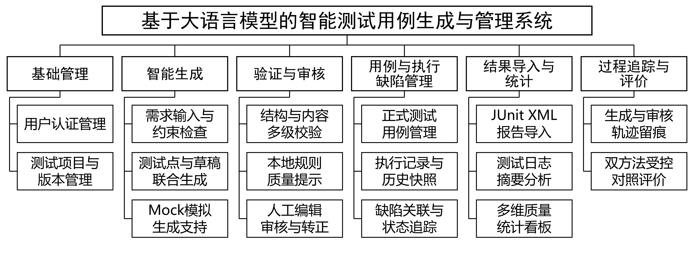

# 湖南涉外经济学院

## 本科毕业论文（设计）开题报告书

| 项目 | 内容 |
| --- | --- |
| 论文（设计）题目 | 基于大语言模型的智能测试用例生成与管理系统设计与实现 |
| 作者姓名 | 郭逢盛 |
| 所属学院专业年级 | 信息与机电工程学院 计算机科学与技术专业 2023级（计科2303） |
| 指导教师姓名、职称 |  |
| 预计字数 | 12000 |
| 开题日期 | 2026年11月  日 |

## 选题的根据

### 一、选题的背景和意义

测试用例设计需要从自然语言需求中识别业务规则，明确前置条件、操作步骤和预期结果，并通过等价类划分、边界值分析等方法组织场景[1]。人工编写的用例容易出现覆盖范围和描述粒度不一致的问题。例如，消费电子产品的蓝牙重连涉及正常重连、连接中断和恢复超时，各情形都需有明确的判定条件。随着版本迭代，分散保存的用例、执行记录和缺陷也会增加问题定位与复现的难度。

本课题拟设计并实现基于大语言模型的智能测试用例生成与管理系统。系统采用关系数据库组织项目、版本、用例、执行和缺陷数据，通过完整性约束和事务维持记录一致性[2]。课题按照软件工程的需求分析、设计、实现和验证过程展开[3]，以 Python 处理 Web 业务和数据[4]，利用大语言模型的文本理解和生成能力，从需求描述中提取测试点并形成用例草稿[5]。

系统为测试人员提供可审查的草稿，并将审核、执行和缺陷记录串联起来。测试人员可依据生成来源、审核变化与执行快照，回溯缺陷对应的版本和复现条件。课题将通过对照评价分析模型在功能测试设计中的适用范围。

### 二、国内外发展情况

国外的 TestRail、Zephyr、TestLink 和国内的禅道、MeterSphere 等工具支持管理用例、测试计划和执行记录。传统流程通常由测试人员依据需求编写或导入用例。部分产品已支持基于需求材料的智能生成，具体能力随版本与模型配置而异。生成的用例在执行前仍需核对需求条件、步骤和预期结果。

国内研究主要涉及大语言模型输出的可靠性及其在测试任务中的应用。刘泽垣等梳理了模型幻觉的成因、检测与缓解方法，为识别生成用例中缺乏需求依据的内容提供参考[6]。香佳宏等总结了大模型在软件缺陷检测与修复中的应用，研究范围包括界面自动化测试和测试用例生成[7]。李岩等梳理了大语言模型用于模糊测试的研究，讨论模型在测试输入构造等环节的作用[8]。中国计算机学会的行业交流介绍了测试数据生成、测试点提示与补充等实践[9]。赵鑫对大语言模型能力扩展的技术演进进行讨论，为理解模型在具体任务中的能力变化提供背景[10]。

国际发表的研究同时关注生成方法和评价标准。Wang 等梳理了大语言模型在软件测试中的代表性任务、提示方式和配套技术，将测试用例准备列为重要方向[11]。Schäfer 等以函数签名、实现及用法示例为输入生成 JavaScript 单元测试，并通过语句和分支覆盖考察生成效果[12]。Yuan 等考察生成测试的正确性、充分性、可读性与可用性，记录了编译和执行失败[13]。Li 等以开源软件为测试对象、以人工测试结果为基准，构建了模型软件测试能力的评价框架[14]。Folorunsho 和 Reza 聚焦自然语言需求到测试用例的转换，归纳了需求歧义处理、结果追溯和评价口径等问题[15]。

综上所述，本课题聚焦模型生成与测试管理衔接中的三项问题。其一，需求、草稿与正式用例分散时，生成结果难以延续到执行和缺陷跟踪。其二，校验与审核缺少连续记录时，难以追溯草稿的采纳依据。其三，格式规范性与用例语义质量容易混用。本课题将通过流程衔接、审核留痕及独立人工评价解决这些问题。

### 三、个人见解

本课题将大语言模型定位为测试设计的辅助增强工具。模型负责整理场景和起草用例，测试人员负责判断需求符合度、决定草稿是否入库，并对正式用例的使用负责。

1. **以结构化契约规范模型输出**。明确测试点、用例草稿和限制说明的字段及约束，在一次模型调用中联合生成。测试点概括正常、异常和边界场景，草稿给出前置条件、操作步骤和可观察的预期结果。
2. **以分层把关保障用例库质量**。结构与内容校验负责检查基本约束，本地规则评分提示格式规范性和结构完整度，测试人员根据业务需求编辑、接受或拒绝草稿。人工接受后创建正式用例，并保留审核前后变化及对应版本的执行快照，便于追溯。
3. **以同口径对照评估适用边界**。在统一需求与模型配置下比较简单提示直接生成和系统结构化生成，按同一参考场景考察用例质量，同时记录生成过程中的可用性表现，分析两种方法各自适用的场景。

## 主要内容

本系统面向测试人员，采用 Flask 构建分层 Web 应用，以 Jinja2 渲染页面，以 Bootstrap 组织界面和表单，以 Chart.js 展示统计结果。业务数据通过 SQLAlchemy 与 SQLite 管理。系统围绕需求输入、草稿生成、人工审核、正式用例、执行记录与缺陷追踪组织六个功能模块，如图 1.1 所示。

**图 1.1 系统功能结构图**

1. **基础管理**。提供用户注册、登录和退出功能，维护测试项目及版本信息。用例和生成会话归属到相应版本，执行记录通过用例关联项目和版本，便于按版本查询。
2. **智能生成**。接收需求文本，检查输入约束，以结构化提示约定输出要求。通过 DeepSeek 接口一次联合生成测试点、用例草稿和限制说明，保留 Mock 模拟方式用于开发、测试和演示。
3. **验证与审核**。校验输出结构、字段类型、枚举取值、文本长度和敏感内容，使用本地规则提示格式与结构完整度。支持人工编辑、接受或拒绝草稿。接受时检查用例编号和版本归属，创建正式用例并保留草稿来源。
4. **用例与执行缺陷管理**。维护用例编号、标题、模块、优先级、场景、前置条件、步骤及预期结果。执行时记录执行状态、实际结果、测试环境和用例快照。缺陷关联至失败执行，支持查询复现条件和跟踪缺陷状态。
5. **结果导入与统计**。解析外部 JUnit XML 报告，按编号匹配目标版本的用例并保存运行批次及执行记录。看板按项目、版本或时间展示执行状态、通过率和缺陷分布，并对上传的测试日志提取等级和关键词摘要。
6. **过程追踪与评价**。记录生成任务、提示版本、模型元数据及初始结构化结果，保存审核人员、审核动作和内容变化，使正式用例可回溯至草稿和生成批次。在统一评价标准下比较简单提示直接生成与系统结构化生成。

## 研究方法

1. **文献研究法**。查阅软件测试、用例生成、大语言模型、提示设计、测试评价与 Web 开发相关资料，梳理需求到用例的转换方法、结构化输出方式及常用评价维度，为生成设计和评价标准提供依据。
2. **系统分析法**。分析测试人员在需求录入、审核入库、用例执行和缺陷追踪中的业务流程和数据需求，借助用例图、活动图及用例描述明确系统边界、状态转换和主要交互。
3. **软件工程方法**。按路由、业务服务和数据模型划分层次，完成模块设计、数据库实体关系与关键交互时序设计，明确多表写入的事务边界。分模块实施并联调核心流程。
4. **对照实验法**。构建包含典型功能需求样本（虚构或演示数据）与参考测试场景的对照实验集，在相同需求输入、模型配置和生成条件下，比较简单提示直接生成与系统结构化生成。依据统一参考场景和评分标准，由实际评价者独立评判生成用例的场景覆盖度、步骤可执行性与预期结果明确性。如实记录生成异常与未决情况，分别统计生成可用性和人工语义质量，分析方案的优势与局限。
5. **软件测试法**。采用等价类划分、边界值分析和异常场景设计，开展单元、接口及浏览器功能测试。重点验证输出校验、审核入库、JUnit 结果导入、数据关联以及异常写入时的事务回滚，并对修改后的功能开展回归测试。

## 完成期限和采取的主要措施

(1) **选题阶段（2026.10.01—2026.11.10）**。确认选题，明确任务书规定的建设目标、研究范围与交付要求，梳理测试用例管理业务并收集相关文献。

(2) **开题阶段（2026.11.11—2026.12.31）**。整理国内外资料，明确模块职责、数据关系和关键业务流程，确定对照方法和评价标准，完成开题报告并根据指导意见完善方案。

(3) **初稿阶段（2027.01.01—2027.03.31）**。完成系统详细设计、核心模块实现和联调，开展系统测试与对照评价，整理设计图表、运行截图及实验材料，按学校安排完成中期检查并形成论文初稿。

(4) **定稿阶段（2027.04.01—2027.04.30）**。根据指导意见修订论文，核对实验统计、图表和引文，按学院要求完成格式检查、查重及论文审核定稿。

(5) **答辩阶段（2027.05.01—2027.05.20）**。准备答辩材料和系统演示，参加答辩并配合成绩评定。根据答辩意见完善论文，提交论文、源代码、数据库设计与使用说明，以及测试、实验等过程材料。

## 主要参考资料

[1]朱少民.软件测试方法和技术[M].4版.北京:清华大学出版社,2022.

[2]王珊,杜小勇,陈红.数据库系统概论[M].6版.北京:高等教育出版社,2023.

[3]张海藩,牟永敏.软件工程导论[M].6版.北京:清华大学出版社,2013.

[4]董付国.Python程序设计:第4版·微课版·在线学习软件版[M].北京:清华大学出版社,2024.

[5]赵鑫,李军毅,周昆,等.大语言模型[M].北京:高等教育出版社,2024.

[6]刘泽垣,王鹏江,宋晓斌,等.大语言模型的幻觉问题研究综述[J].软件学报,2025,36(3):1152-1185.

[7]香佳宏,徐霄阳,孔繁初,等.大模型在软件缺陷检测与修复的应用发展综述[J].软件学报,2025,36(4):1489-1529.

[8]李岩,杨文章,张翼,等.基于大语言模型的模糊测试研究综述[J].软件学报,2025,36(6):2404-2431.

[9]中国计算机学会.TF136回顾 大语言模型，如何赋能测试？[EB/OL].(2024-07-11)[2026-11-03].https://www.ccf.org.cn/Media_list/tf/2024-07-11/827840.shtml.

[10]赵鑫.大语言模型能力扩展的技术演进[J].计算,2026,2(8):44-48.

[11]WANG J,HUANG Y,CHEN C,et al.Software Testing with Large Language Models: Survey, Landscape, and Vision[EB/OL].(2023-07-14)[2026-11-03].https://arxiv.org/abs/2307.07221.

[12]SCHÄFER M,NADI S,EGHBALI A,et al.An Empirical Evaluation of Using Large Language Models for Automated Unit Test Generation[EB/OL].(2023-02-13)[2026-11-03].https://arxiv.org/abs/2302.06527.

[13]YUAN Z,LOU Y,LIU M,et al.No More Manual Tests? Evaluating and Improving ChatGPT for Unit Test Generation[EB/OL].(2023-05-07)[2026-11-03].https://arxiv.org/abs/2305.04207.

[14]LI Y,LIU P,WANG H,et al.Evaluating large language models for software testing[J].Computer Standards & Interfaces,2025,93:103942.

[15]FOLORUNSHO O,REZA H.AI-Driven Test Case Generation from Natural Language Requirements: A Survey of Techniques and Research Gaps[EB/OL].(2026-06-04)[2026-11-03].https://arxiv.org/abs/2606.06563.

## 指导教师意见

指导教师签名：　　　　　　　　　日期：
