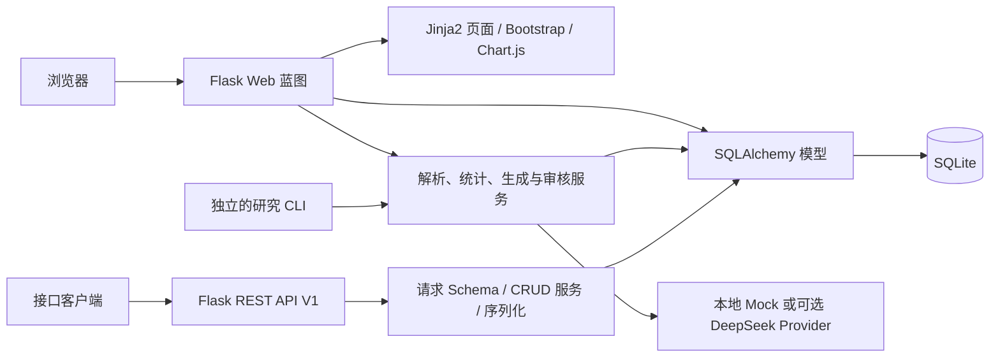
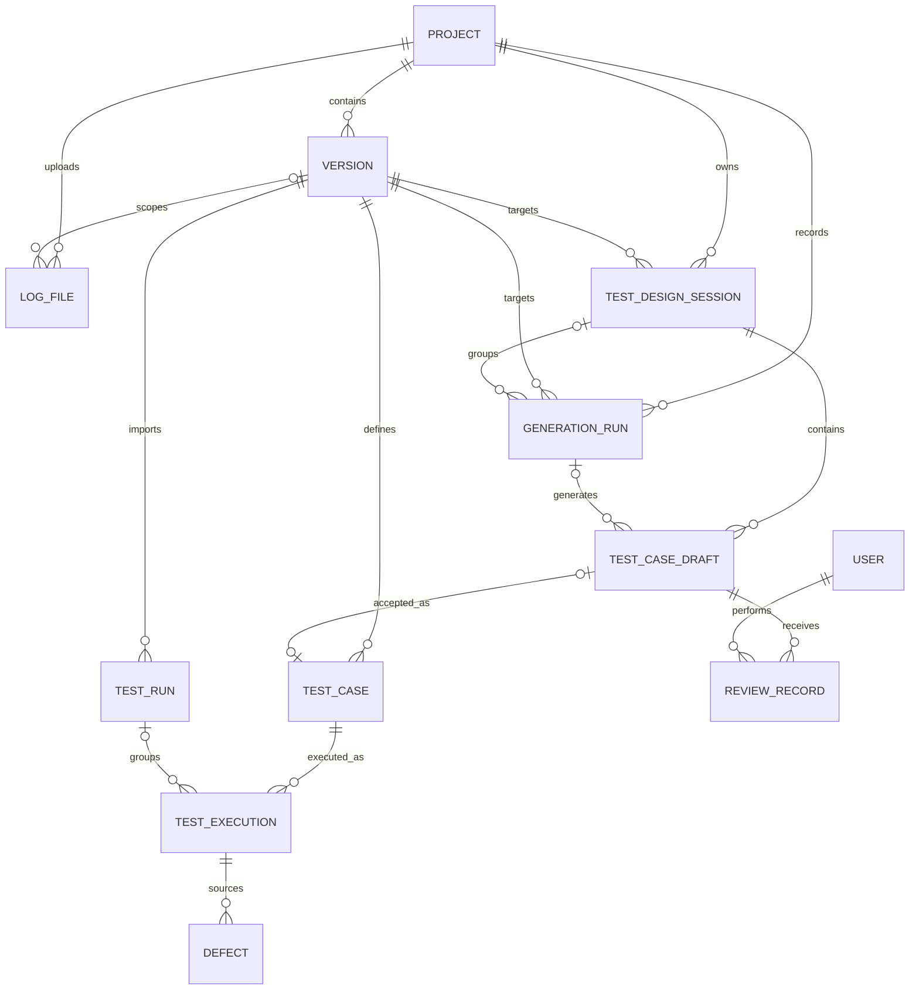

# 项目技术实现全览

核验日期：**2026-11-17（Asia/Shanghai）**。本文以主仓库当前工作区为准：分支 `thesis/llm-experiment-foundation`，HEAD `1f112e4d6291bf0ceaf870857151e8e5a62a232e`，包含已有的未提交修复和未跟踪源码。`app/`、`migrations/`、`tests/`、`scripts/` 的文件集合及内容与 `.pytest_cache/repair-20261112/integration` 一致（忽略文本 CRLF/LF 差异）；隔离目录逐字节匹配 [WEB-02 源码清单](docs/portfolio/evidence/web02-20261113/source-manifest.json) 的 249 项。历史报告仍按各自执行版本和日期引用，不把工作区内容写成已提交的 HEAD 或正式实验所用源码。路径以项目根目录为基准。

## 1. 项目概述与技术栈

本项目是面向音频产品测试场景的 Web 测试管理原型，将项目、版本、用例、执行结果与缺陷串成可追溯的管理链，并提供 JUnit 结果导入、日志分析、统计看板和需要人工审核的 AI 测试设计。

| 层次 | 组件及具体版本 | 在项目中的作用 |
| --- | --- | --- |
| 前端 | Jinja2 **3.1.6**；Bootstrap **5.3.3**；Chart.js **4.4.7**；HTML、CSS、原生 JavaScript | Jinja2 在服务器渲染页面；Bootstrap 和 Chart.js 由模板以固定版本引用 CDN；自有 CSS 和生成表单脚本由 Flask 提供。没有 `package.json` 或前端构建流程。 |
| 语言与 Web | 本机项目虚拟环境 Python **3.14.3**；Docker/CI 指定 Python **3.12**（未固定补丁号）；Flask **3.1.3**；Werkzeug **3.1.8**；Click **8.4.2** | Flask 应用工厂、Blueprint、请求处理和 CLI；Werkzeug 提供口令散列校验及文件名清理。 |
| 登录和配置 | Flask-Login **0.6.3**；python-dotenv **1.2.2** | Flask-Login 管理网页登录会话；本地 Flask 启动支持环境变量及 dotenv，配置示例见 `.env.example`。 |
| 数据库 | SQLite **3.50.4**（本机 Python 绑定）；Flask-SQLAlchemy **3.1.1**；SQLAlchemy **2.0.51**；Flask-Migrate **4.1.0**；Alembic **1.18.5** | SQLite 单文件持久化；ORM、事务和版本迁移。容器内 SQLite 的具体版本未实测。 |
| 校验、导入与模型 | Pydantic **2.13.4**；defusedxml **0.7.1**；OpenAI Python SDK **2.45.0**、其 HTTP 依赖 httpx **0.28.1** | 校验 REST 请求和模型结构化输出、安全解析 JUnit XML；OpenAI SDK 用作 DeepSeek 兼容接口客户端，Mock 在本地生成。DeepSeek 模型通过配置选择，源码无固定默认模型名。 |
| 中间件和运行 | Gunicorn **23.0.0**；Docker CLI **29.4.3**、Docker Compose **v5.1.3**（本机命令版本） | Gunicorn 提供容器的 WSGI 服务；Compose 编排单个 Web 容器和持久卷。当前源码/编排未集成独立缓存、消息队列、后台任务服务或反向代理。 |
| 质量工具 | pytest **8.4.2**；pytest-cov **7.1.0**；coverage.py **7.15.0**；Ruff **0.15.21**；PyYAML **6.0.3**；GitHub Actions `actions/checkout@v7`、`actions/setup-python@v6` | 测试、行覆盖率、静态检查、测试中读取 YAML 编排配置；部分前端测试可用 Node.js 执行事件脚本，本机为 Node.js **24.15.0**，不属于应用运行依赖。 |

Python 包具体版本来自本次读取 `.venv` 已安装元数据。仓库没有 Python 精确锁定文件：[requirements.txt](requirements.txt) 约束 Flask `>=3.0,<4.0`、Flask-SQLAlchemy `>=3.1,<4.0`、Flask-Migrate `>=4.0,<5.0`、Flask-Login `>=0.6,<1.0`、python-dotenv `>=1.0,<2.0`、defusedxml `>=0.7.1,<1.0`、OpenAI SDK `>=2,<3`、Pydantic `>=2.7,<3`、Gunicorn `>=23.0,<24.0`；[requirements-dev.txt](requirements-dev.txt) 另约束 pytest `>=8,<9`、pytest-cov `>=7,<8`、Ruff `>=0.15,<1`、PyYAML `>=6,<7`。本机版本不能作为容器或每次 CI 的依赖锁定结果。

[config.py](config.py) 默认数据库为 `instance/audio_test_platform.sqlite`，可用 `DATABASE_URI` 指定连接；默认 `AI_ENABLED=false`、`AI_PROVIDER=mock`、请求超时 20 秒、输入配置上限 12,000 字符、输出上限 2,000 tokens。需求生成另有更严格的 20–2,000 字符 Schema。默认配置描述的是源码行为，运行时由进程实际配置决定。

## 2. 目录结构与系统架构

### 2.1 核心目录树

```text
audio-test-management-platform/
├── app/
│   ├── __init__.py                    # create_app、蓝图注册、登录加载器、演示 Seed
│   ├── extensions.py                 # SQLAlchemy、Migrate、LoginManager、SQLite 外键开关
│   ├── models.py                     # 12 张业务表及 ORM 关系、快照、审计保护
│   ├── blueprints/
│   │   ├── auth/  dashboard/          # 登录注册、统计看板
│   │   ├── projects/  versions/       # 项目、版本
│   │   ├── testcases/  executions/  defects/
│   │   ├── test_runs/  logs/          # JUnit 导入、日志上传与分析
│   │   ├── ai_test_design/           # 生成、Run 查询、草稿审核
│   │   └── api_v1/                   # REST 控制器、请求 Schema、序列化和错误处理
│   ├── services/
│   │   ├── test_design_service.py   # 测试设计生成和审核编排
│   │   ├── test_design/             # 联合生成 Prompt、Schema、Provider、评分、诊断、证据
│   │   ├── ai/                      # 已有用例语义审查的 Provider、Schema、Prompt
│   │   ├── testcase* / execution* / defect*  # 业务规则、用例审查及 REST 服务
│   │   └── junit_* / log_analysis_service.py / dashboard_service.py
│   ├── templates/                   # Jinja2 基础模板及各业务页面
│   └── static/                      # 自定义 CSS、生成表单 JS
├── migrations/versions/             # 14 个 Alembic 版本脚本
├── tests/                           # pytest 测试、共用 fixture、JUnit XML 样例
├── scripts/                         # API Smoke、单次生成 Smoke、Pilot、正式执行、Mock 演示
├── experiment/                      # 研究数据、基线/提出方法适配、受控执行与历史报告
│   ├── dataset/  pilot_dataset/     # 虚构需求、参考场景；参考不进入生成请求
│   ├── formal_*.py                  # 正式计划、适配、编排、证据存储
│   └── framework.py / adapters.py / normalization.py
├── docs/                            # API 合同、演示说明、阶段报告、验收证据
├── instance/                        # 本地运行数据目录
├── docker/entrypoint.sh              # 迁移、可选初始化、交给 WSGI 主进程
├── .github/workflows/ci.yml          # Python 质量检查
└── run.py / config.py / test_design_contract.py / requirements*.txt /
    pyproject.toml / Dockerfile / compose.yaml / .env.example
```

树图仅展示应用源码、配置和证据入口，省略版本控制、缓存、虚拟环境和二进制运行产物。

### 2.2 请求链路和模块边界

系统采用 **Flask 单体应用、服务端渲染与分层组织**。`run.py` 调用 [create_app](app/__init__.py) 装载配置和共享扩展、注册 11 个业务/认证/REST 蓝图；Web 表单由控制器处理后渲染 Jinja2 或重定向，`/api/v1` 则使用专门的 Pydantic Schema、服务组件和 JSON 序列化。复杂逻辑集中在 services，部分基础 Web CRUD 在各蓝图内直接校验表单并操作 ORM，不能假设 Web 与 REST 全部复用同一套校验器。



AI 测试设计由 HTTP POST 同步执行，前端等待提示只负责交互；Run 表跟踪状态，并不代表后台任务队列。实验编排由独立 CLI 启动，业务 Web 没有批量正式实验调度页面。容器应用按 Dockerfile 的 COPY 白名单打包，`scripts/`、`experiment/` 和 `tests/` 不进入运行镜像。

## 3. 核心功能模块拆解

| 业务模块 | 输入 | 实际处理 | 输出和落库 |
| --- | --- | --- | --- |
| 登录与注册 | 用户名、邮箱、口令；退出时为已登录会话 | 注册校验非空及邮箱重复，邮箱去空白转小写，使用 Werkzeug 存储口令散列；登录校验散列并建立 Flask-Login 会话，退出清理会话。 | `user` 账户及会话 Cookie；公开目录和 REST 接口没有统一登录门槛，AI 草稿编辑/接受/拒绝单独要求登录。 |
| 项目管理 | 名称、编码、描述、`active/archived` | 列表/详情/新增/编辑/删除；编码大写、全局唯一；存在版本时禁止直接删除，数据库关联冲突回滚。 | `project` 记录、详情和状态；归档是状态更新。 |
| 版本管理 | 项目、名称、编码、描述、`planned/testing/released/archived` | 验证所属项目、同项目编码唯一；已有 AI Session 时不允许移到其他项目；存在用例或设计会话时拦截删除。Web 表单固定 `release_type=sample`，不提供计划日期编辑。 | `version` 记录，挂接用例、自动化导入批次、日志和设计会话。 |
| 测试用例管理 | 版本、编号、标题、模块、优先级、前置条件、步骤、预期及状态 | 创建/查看/编辑/删除清单用例；编码大写、版本内唯一，类型 `checklist`，状态 `draft/active/archived`；有执行记录或被某草稿接受形成的正式用例受删除保护；REST 提供列表筛选、详情和创建。 | `test_case` 正式用例表记录。这里的 `draft` 是正式表的业务状态，与 AI 草稿不是一回事。 |
| 手工执行记录 | 用例 ID、结果、测试人员、环境、实际结果、时间、备注 | 新建时固化用例内容快照；结果支持 `passed/failed/blocked/skipped`，失败关联实际结果。编辑不允许改所属用例，删除已有缺陷的记录会被阻止。REST 对 `blocked` 另要求实际结果或备注，传入时间必须带时区。 | `test_execution`；向下关联缺陷，向上回溯原用例及其执行时内容。页面保存的是执行记录，设备操作由实际测试人员执行。 |
| 缺陷管理 | 失败执行、编号、标题、描述、模块、严重度、优先级、复现步骤、观察结果、提交人、负责人和解决信息 | 只从 `failed` 执行新建，固化环境/结果/时间快照；编号全局唯一，编辑保留来源和编号，支持列表、详情、编辑、删除。REST 创建和更新检查状态与解决信息组合；PATCH 另限定可更新字段。 | `defect`；状态为 `open/fixed/closed/rejected`。提交人/负责人是文本，不是账号外键或任务分派系统。 |
| 自动化结果导入 | 目标版本、JUnit XML 文件、可选 runner/环境 | 安全解析嵌套 suite；根据 XML 的 `platform_test_case_code` 在目标版本匹配既有用例；按报告哈希和版本防重；任一用例匹配失败就拒绝整批。 | `test_run` 与多条 `test_execution`、快照及结果分布；批次详情反查关联执行。不调度或运行测试脚本。 |
| 日志分析 | 项目、可选同项目版本、`.log/.txt`、可选备注 | 同步校验并读取文本，按行匹配严重等级和领域关键词、生成风险摘要；按项目和文件哈希去重，登录用户记录用户名，未登录记演示上传者。 | `log_file` 元数据、计数、风险等级、截断标记和有限的行号/文本片段；不保留原始文件。 |
| Dashboard | `project_id`、`version_id`、时间范围 `7d/30d/all` | 验证筛选关系，无效参数回退；以数据库聚合执行、版本和缺陷，按日期计算失败趋势，展示待关注项。通过率 = passed ÷ (passed + failed)，失败率分母相同，blocked/skipped 不进入分母，分母为零时返回空值（`None`），表示没有可计算的通过率或失败率。 | 统计卡片、结果分布、失败趋势、缺陷状态/严重度图、版本质量表、失败/阻塞及需关注缺陷列表；只读。 |
| 已有用例 AI 审查 | 已存在的 TestCase 及所属 Version、Project；须启用 `AI_ENABLED` | 本地规则检查后，调用 Mock 或 DeepSeek 语义审查；限制上下文长度，校验结构，按类别与证据去重并本地扣分。 | 在用例详情显示问题、建议、局限和质量分；该路径不写入草稿或审核事件，也不修改原用例。 |
| AI 测试设计生成 | 项目、所属版本、标题、虚构需求、Web 提交键 | 单次生成测试点和草稿，执行 Schema、安全/演示范围检查和本地评分；数据库防重，记录结果与错误；表单展示当前模式和等待/离线提示。Mock 路径在默认关闭外部 AI 时仍可使用。 | 成功写入 `generation_run`、`test_design_session`、`test_case_draft`，通过页面查看测试点、限制、分数、调用历史及诊断。生成本身不写 `test_case`。 |
| 草稿人工审核 | 登录用户、草稿、可选备注、草稿及会话的 revision；编辑提交九个内容字段 | 仅审核 pending 草稿，验证字段和版本；更新内容、接受或拒绝，重新统计会话状态及规则分；记录审核前后快照。 | 编辑或拒绝不创建正式记录；人工接受成功创建一条 `test_case`，初始状态 `draft`，关联源草稿；写入 `review_record` 及编辑/接受/拒绝统计。 |
| API 和演示工具 | JSON 客户端、JUnit 样例、独立演示库选项 | REST API 提供健康检查和关键业务读写；`api_smoke.py/.ps1` 用虚构数据验证接口链；`init-db` 在已迁移库初始化/更新 Demo 数据；`run_repair_demo.py` 可创建隔离 Mock 库并在重启时复用。 | 接口 JSON、Smoke 输出或独立演示库。已有演示库复用只检查迁移版本，不自动 Seed 或升级。 |
| 研究实验工具 | 虚构需求集、方法版本、受控参数和计划 | `run_pilot.py` 编排小样本；`run_experiment.py` 默认只输出正式计划，显式执行模式才进入前置核验；Baseline 自由文本按冻结规则逐字转录，Proposed 走结构化生成及持久化链，研究层记录逐次状态与来源。 | manifest、state、逐次记录、可核验导出及 Proposed 独立 SQLite；参考场景用于人工对照，规则分与人工评价独立。 |

实现入口：[Web 蓝图](app/blueprints)、[业务服务](app/services)、[日志解析](app/services/log_analysis_service.py)、[看板聚合](app/services/dashboard_service.py)、[已有用例审查](app/services/testcase_ai_service.py)、[实验执行说明](experiment/EXECUTION_README.md)。

## 4. 数据库设计（用于画 E-R 图与表结构）

### 4.1 模型、迁移与关系

从 [app/models.py](app/models.py) 的 SQLAlchemy 元数据提取 **12 张业务表、175 个字段**。另有 Alembic 管理的 `alembic_version` 元数据表（`version_num VARCHAR(32)` 为非空主键），不属于业务 E-R 实体。源码迁移链的当前 head 是 [e8f3a7c1d902](migrations/versions/e8f3a7c1d902_add_generation_submission_safety.py)，新增两个 revision 字段、四个 Run 字段和两个唯一索引；该脚本明确不支持降级。本次只读查看默认本地 SQLite 主文件，`alembic_version` 仍为 **`d7e2f6a9b301`**；以下设计对应当前源码及其迁移 head，不能当作旧本地库已完成升级的证明。SQLite 连接由 [extensions.py](app/extensions.py) 开启外键检查。



核心链是 Project 1:N Version 1:N TestCase 1:N TestExecution 1:N Defect。一次导入可关联多条执行，单条手工执行可无导入批次。Session 关联多个 Run 和草稿；早期草稿的 Run 外键可空。草稿与被接受的正式用例是可选一对一，CHECK 同时约束接受状态与链接是否存在。日志、Session、Run 的项目和版本使用独立外键；新建日志/生成时由业务层验证版本归属，不能把它画成组合外键。数据库的表间引用和应用级删除保护应分开说明。

以下类型按 ORM 声明列示；`DATETIME（timezone=True）` 表示 ORM 参数，SQLite 本身没有独立时区类型。`utc_now` 为应用侧 UTC 默认值，不等同于数据库触发器。没有标记 ON DELETE 的 FK 使用数据库默认行为；唯一索引、组合唯一键和 CHECK 在表后列示。SQLite 对可空唯一列允许多条 NULL。JSON 快照是 `TEXT`，不是专用 JSON 类型，也不是独立实体表。

### 4.2 user（User）

Web 账户及审核人员身份。邮箱唯一；用户名无唯一约束。 [模型源码](app/models.py#L14)。

| 字段 | 类型 | 约束／默认 |
| --- | --- | --- |
| `id` | `INTEGER` | PK；非空 |
| `username` | `VARCHAR(80)` | 非空 |
| `email` | `VARCHAR(120)` | 非空；唯一索引 |
| `password_hash` | `VARCHAR(255)` | 非空 |
| `created_at` | `DATETIME（timezone=True）` | 非空；ORM 默认 utc_now |

索引：`ix_user_email` 唯一 `(email)`。


### 4.3 project（Project）

测试项目及归档状态，是版本、日志和 AI 设计的归属。 [模型源码](app/models.py#L38)。

| 字段 | 类型 | 约束／默认 |
| --- | --- | --- |
| `id` | `INTEGER` | PK；非空 |
| `name` | `VARCHAR(120)` | 非空 |
| `code` | `VARCHAR(40)` | 非空；唯一索引 |
| `description` | `TEXT` | 可空 |
| `status` | `VARCHAR(30)` | 非空；ORM 默认 active |
| `created_at` | `DATETIME（timezone=True）` | 非空；ORM 默认 utc_now |
| `updated_at` | `DATETIME（timezone=True）` | 非空；ORM 默认 utc_now；ORM 更新 utc_now |

索引：`ix_project_code` 唯一 `(code)`。


### 4.4 version（Version）

项目内的测试版本，版本编码在项目范围内唯一。 [模型源码](app/models.py#L70)。

| 字段 | 类型 | 约束／默认 |
| --- | --- | --- |
| `id` | `INTEGER` | PK；非空 |
| `project_id` | `INTEGER` | 非空；FK → `project.id` |
| `name` | `VARCHAR(120)` | 非空 |
| `code` | `VARCHAR(80)` | 非空 |
| `description` | `TEXT` | 可空 |
| `release_type` | `VARCHAR(40)` | 非空；ORM 默认 sample |
| `status` | `VARCHAR(30)` | 非空；ORM 默认 planned |
| `planned_test_date` | `DATE` | 可空 |
| `created_at` | `DATETIME（timezone=True）` | 非空；ORM 默认 utc_now |
| `updated_at` | `DATETIME（timezone=True）` | 非空；ORM 默认 utc_now；ORM 更新 utc_now |

表约束：`uq_version_project_code`：`UNIQUE (project_id, code)`。


### 4.5 test_case（TestCase）

正式清单用例；来源可以是人工创建、接口创建或人工接受 AI 草稿。 [模型源码](app/models.py#L156)。

| 字段 | 类型 | 约束／默认 |
| --- | --- | --- |
| `id` | `INTEGER` | PK；非空 |
| `version_id` | `INTEGER` | 非空；FK → `version.id` |
| `title` | `VARCHAR(200)` | 非空 |
| `code` | `VARCHAR(80)` | 非空 |
| `module` | `VARCHAR(80)` | 非空 |
| `priority` | `VARCHAR(20)` | 非空；ORM 默认 P2 |
| `case_type` | `VARCHAR(40)` | 非空；ORM 默认 checklist |
| `precondition` | `TEXT` | 可空 |
| `steps` | `TEXT` | 非空 |
| `expected_result` | `TEXT` | 非空 |
| `status` | `VARCHAR(30)` | 非空；ORM 默认 draft |
| `created_at` | `DATETIME（timezone=True）` | 非空；ORM 默认 utc_now |
| `updated_at` | `DATETIME（timezone=True）` | 非空；ORM 默认 utc_now；ORM 更新 utc_now |

表约束：`uq_test_case_version_code`：`UNIQUE (version_id, code)`。

索引：`ix_test_case_status` `(status)`。


### 4.6 test_run（TestRun）

一次已导入的 JUnit 报告批次；哈希针对文件原始字节。 [模型源码](app/models.py#L111)。

| 字段 | 类型 | 约束／默认 |
| --- | --- | --- |
| `id` | `INTEGER` | PK；非空 |
| `version_id` | `INTEGER` | 非空；FK → `version.id` |
| `source_type` | `VARCHAR(30)` | 非空；ORM 默认 junit_xml |
| `report_hash` | `VARCHAR(64)` | 非空 |
| `runner` | `VARCHAR(80)` | 可空 |
| `environment` | `VARCHAR(120)` | 可空 |
| `started_at` | `DATETIME（timezone=True）` | 可空 |
| `finished_at` | `DATETIME（timezone=True）` | 可空 |
| `imported_at` | `DATETIME（timezone=True）` | 非空；ORM 默认 utc_now |
| `created_at` | `DATETIME（timezone=True）` | 非空；ORM 默认 utc_now |

表约束：`uq_test_run_version_source_hash`：`UNIQUE (version_id, source_type, report_hash)`。

索引：`ix_test_run_version_id` `(version_id)`。


### 4.7 test_execution（TestExecution）

单次执行及用例历史快照。无批次的手工执行可留空 `test_run_id`、`external_case_key` 和 `duration_seconds`。 [模型源码](app/models.py#L524)。

| 字段 | 类型 | 约束／默认 |
| --- | --- | --- |
| `id` | `INTEGER` | PK；非空 |
| `test_run_id` | `INTEGER` | 可空；FK → `test_run.id` |
| `test_case_id` | `INTEGER` | 非空；FK → `test_case.id` |
| `external_case_key` | `VARCHAR(255)` | 可空 |
| `duration_seconds` | `NUMERIC(10, 3)` | 可空 |
| `result` | `VARCHAR(30)` | 非空；ORM 默认 passed |
| `actual_result` | `TEXT` | 可空 |
| `tester` | `VARCHAR(80)` | 非空 |
| `environment` | `VARCHAR(120)` | 可空 |
| `executed_at` | `DATETIME（timezone=True）` | 非空；ORM 默认 utc_now |
| `notes` | `TEXT` | 可空 |
| `test_case_code_snapshot` | `VARCHAR(80)` | 非空 |
| `test_case_title_snapshot` | `VARCHAR(200)` | 非空 |
| `precondition_snapshot` | `TEXT` | 可空 |
| `steps_snapshot` | `TEXT` | 非空 |
| `expected_result_snapshot` | `TEXT` | 非空 |
| `created_at` | `DATETIME（timezone=True）` | 非空；ORM 默认 utc_now |
| `updated_at` | `DATETIME（timezone=True）` | 非空；ORM 默认 utc_now；ORM 更新 utc_now |

表约束：`uq_test_execution_run_external_key`：`UNIQUE (test_run_id, external_case_key)`。

索引：`ix_test_execution_executed_at` `(executed_at)`；`ix_test_execution_result` `(result)`；`ix_test_execution_test_case_id` `(test_case_id)`；`ix_test_execution_test_run_id` `(test_run_id)`。


### 4.8 defect（Defect）

由失败执行派生的缺陷，保留环境、实际结果、执行时间快照。 [模型源码](app/models.py#L588)。

| 字段 | 类型 | 约束／默认 |
| --- | --- | --- |
| `id` | `INTEGER` | PK；非空 |
| `test_execution_id` | `INTEGER` | 非空；FK → `test_execution.id` |
| `code` | `VARCHAR(40)` | 非空；唯一索引 |
| `title` | `VARCHAR(200)` | 非空 |
| `description` | `TEXT` | 非空 |
| `component` | `VARCHAR(80)` | 非空 |
| `severity` | `VARCHAR(20)` | 非空；ORM 默认 major |
| `priority` | `VARCHAR(20)` | 非空；ORM 默认 P2 |
| `status` | `VARCHAR(30)` | 非空；ORM 默认 open |
| `reproduction_steps` | `TEXT` | 非空 |
| `observed_result` | `TEXT` | 非空 |
| `reporter` | `VARCHAR(80)` | 非空 |
| `assignee` | `VARCHAR(80)` | 可空 |
| `resolution` | `VARCHAR(80)` | 可空 |
| `resolution_note` | `TEXT` | 可空 |
| `environment_snapshot` | `VARCHAR(120)` | 可空 |
| `actual_result_snapshot` | `TEXT` | 可空 |
| `executed_at_snapshot` | `DATETIME（timezone=True）` | 非空 |
| `created_at` | `DATETIME（timezone=True）` | 非空；ORM 默认 utc_now |
| `updated_at` | `DATETIME（timezone=True）` | 非空；ORM 默认 utc_now；ORM 更新 utc_now |

索引：`ix_defect_code` 唯一 `(code)`；`ix_defect_test_execution_id` `(test_execution_id)`。


### 4.9 log_file（LogFile）

项目日志文件元数据、等级计数和摘要；`analysis_summary` 为 JSON 文本，`uploaded_by` 为用户名字符串。 [模型源码](app/models.py#L632)。

| 字段 | 类型 | 约束／默认 |
| --- | --- | --- |
| `id` | `INTEGER` | PK；非空 |
| `project_id` | `INTEGER` | 非空；FK → `project.id` |
| `version_id` | `INTEGER` | 可空；FK → `version.id` |
| `filename` | `VARCHAR(200)` | 非空 |
| `file_size_bytes` | `INTEGER` | 非空 |
| `sha256` | `VARCHAR(64)` | 非空 |
| `analysis_status` | `VARCHAR(30)` | 非空；ORM 默认 completed |
| `risk_level` | `VARCHAR(20)` | 非空 |
| `total_lines` | `INTEGER` | 非空 |
| `critical_count` | `INTEGER` | 非空；ORM 默认 0 |
| `error_count` | `INTEGER` | 非空；ORM 默认 0 |
| `warning_count` | `INTEGER` | 非空；ORM 默认 0 |
| `info_count` | `INTEGER` | 非空；ORM 默认 0 |
| `analysis_summary` | `TEXT` | 非空 |
| `uploaded_by` | `VARCHAR(80)` | 非空 |
| `notes` | `TEXT` | 可空 |
| `uploaded_at` | `DATETIME（timezone=True）` | 非空；ORM 默认 utc_now |

表约束：`uq_log_file_project_sha256`：`UNIQUE (project_id, sha256)`。


### 4.10 test_design_session（TestDesignSession）

一次测试设计会话及其聚合审核状态。测试点和局限分别存为 JSON 文本；`review_revision` 是会话级乐观锁。 [模型源码](app/models.py#L193)。

| 字段 | 类型 | 约束／默认 |
| --- | --- | --- |
| `review_revision` | `INTEGER` | 非空；ORM 默认 1；数据库默认 1 |
| `id` | `INTEGER` | PK；非空 |
| `project_id` | `INTEGER` | 非空；FK → `project.id` |
| `version_id` | `INTEGER` | 非空；FK → `version.id` |
| `title` | `VARCHAR(200)` | 非空 |
| `requirement_text` | `TEXT` | 非空 |
| `status` | `VARCHAR(30)` | 非空；ORM 默认 generated |
| `provider` | `VARCHAR(30)` | 非空 |
| `provider_model` | `VARCHAR(120)` | 可空 |
| `prompt_version` | `VARCHAR(40)` | 非空 |
| `quality_score` | `INTEGER` | 非空 |
| `test_points_json` | `TEXT` | 非空 |
| `limitations_json` | `TEXT` | 非空 |
| `created_at` | `DATETIME（timezone=True）` | 非空；ORM 默认 utc_now |
| `updated_at` | `DATETIME（timezone=True）` | 非空；ORM 默认 utc_now；ORM 更新 utc_now |

表约束：`ck_test_design_session_provider`：`CHECK (provider IN ('mock', 'deepseek'))`；`ck_test_design_session_quality_score`：`CHECK (quality_score >= 0 AND quality_score <= 100)`；`ck_test_design_session_status`：`CHECK (status IN ('generated', 'partially_reviewed', 'accepted', 'rejected'))`。

索引：`ix_test_design_session_project_id` `(project_id)`；`ix_test_design_session_provider` `(provider)`；`ix_test_design_session_status` `(status)`；`ix_test_design_session_version_id` `(version_id)`。


### 4.11 generation_run（GenerationRun）

一次生成尝试、输入/模板摘要、Provider/模型、耗时、用量、结构化输出或安全诊断。`session_id` 允许为空，以保留生成失败、运行中及待确认记录。 [模型源码](app/models.py#L362)。

| 字段 | 类型 | 约束／默认 |
| --- | --- | --- |
| `id` | `INTEGER` | PK；非空 |
| `session_id` | `INTEGER` | 可空；FK → `test_design_session.id`（ON DELETE RESTRICT） |
| `project_id` | `INTEGER` | 非空；FK → `project.id`（ON DELETE RESTRICT） |
| `version_id` | `INTEGER` | 非空；FK → `version.id`（ON DELETE RESTRICT） |
| `title` | `VARCHAR(200)` | 非空 |
| `requirement_text` | `TEXT` | 非空 |
| `provider` | `VARCHAR(30)` | 非空 |
| `provider_model` | `VARCHAR(120)` | 可空 |
| `prompt_version` | `VARCHAR(40)` | 非空 |
| `prompt_hash` | `VARCHAR(64)` | 非空 |
| `requirement_hash` | `VARCHAR(64)` | 非空 |
| `status` | `VARCHAR(30)` | 非空；ORM 默认 running |
| `started_at` | `DATETIME（timezone=True）` | 非空；ORM 默认 utc_now |
| `finished_at` | `DATETIME（timezone=True）` | 可空 |
| `latency_ms` | `INTEGER` | 可空 |
| `input_chars` | `INTEGER` | 可空 |
| `output_chars` | `INTEGER` | 可空 |
| `prompt_tokens` | `INTEGER` | 可空 |
| `completion_tokens` | `INTEGER` | 可空 |
| `total_tokens` | `INTEGER` | 可空 |
| `finish_reason` | `VARCHAR(80)` | 可空 |
| `temperature` | `FLOAT` | 可空 |
| `max_tokens` | `INTEGER` | 可空 |
| `error_type` | `VARCHAR(80)` | 可空 |
| `error_message` | `TEXT` | 可空 |
| `structured_output_json` | `TEXT` | 可空 |
| `request_key` | `VARCHAR(128)` | 可空；唯一索引 |
| `request_fingerprint` | `VARCHAR(64)` | 可空 |
| `active_request_scope` | `VARCHAR(64)` | 可空；唯一索引 |
| `validation_summary_json` | `TEXT` | 可空 |
| `created_at` | `DATETIME（timezone=True）` | 非空；ORM 默认 utc_now |

表约束：`ck_generation_run_provider`：`CHECK (provider IN ('mock', 'deepseek'))`；`ck_generation_run_status`：`CHECK (status IN ('running', 'succeeded', 'failed'))`。

索引：`ix_generation_run_project_id` `(project_id)`；`ix_generation_run_provider` `(provider)`；`ix_generation_run_session_id` `(session_id)`；`ix_generation_run_status` `(status)`；`ix_generation_run_version_id` `(version_id)`；`uq_generation_run_active_scope` 唯一 `(active_request_scope)`；`uq_generation_run_request_key` 唯一 `(request_key)`。


### 4.12 test_case_draft（TestCaseDraft）

待审测试用例草稿；`revision` 是草稿级乐观锁，`accepted_test_case_id` 保存接受后的正式用例链接。 [模型源码](app/models.py#L271)。

| 字段 | 类型 | 约束／默认 |
| --- | --- | --- |
| `revision` | `INTEGER` | 非空；ORM 默认 1；数据库默认 1 |
| `id` | `INTEGER` | PK；非空 |
| `session_id` | `INTEGER` | 非空；FK → `test_design_session.id`（ON DELETE CASCADE） |
| `generation_run_id` | `INTEGER` | 可空；FK → `generation_run.id`（ON DELETE RESTRICT） |
| `suggested_code` | `VARCHAR(80)` | 非空 |
| `title` | `VARCHAR(200)` | 非空 |
| `module` | `VARCHAR(80)` | 非空 |
| `priority` | `VARCHAR(20)` | 非空 |
| `case_type` | `VARCHAR(40)` | 非空 |
| `precondition` | `TEXT` | 可空 |
| `steps` | `TEXT` | 非空 |
| `expected_result` | `TEXT` | 非空 |
| `scenario_type` | `VARCHAR(30)` | 非空 |
| `status` | `VARCHAR(30)` | 非空；ORM 默认 pending |
| `accepted_test_case_id` | `INTEGER` | 可空；FK → `test_case.id` |
| `created_at` | `DATETIME（timezone=True）` | 非空；ORM 默认 utc_now |
| `updated_at` | `DATETIME（timezone=True）` | 非空；ORM 默认 utc_now；ORM 更新 utc_now |

表约束：`ck_test_case_draft_accepted_link`：`CHECK ((status = 'accepted' AND accepted_test_case_id IS NOT NULL) OR (status != 'accepted' AND accepted_test_case_id IS NULL))`；`ck_test_case_draft_scenario_type`：`CHECK (scenario_type IN ('normal', 'negative', 'boundary', 'compatibility', 'recovery', 'security'))`；`ck_test_case_draft_status`：`CHECK (status IN ('pending', 'accepted', 'rejected'))`；`uq_test_case_draft_accepted_case`：`UNIQUE (accepted_test_case_id)`。

索引：`ix_test_case_draft_generation_run_id` `(generation_run_id)`；`ix_test_case_draft_session_id` `(session_id)`；`ix_test_case_draft_status` `(status)`。


### 4.13 review_record（ReviewRecord）

审核员对一条草稿的 edit/accept/reject 事件；前后快照、变动字段数组为 JSON 文本，前后分是会话规则分。 [模型源码](app/models.py#L438)。

| 字段 | 类型 | 约束／默认 |
| --- | --- | --- |
| `id` | `INTEGER` | PK；非空 |
| `draft_id` | `INTEGER` | 非空；FK → `test_case_draft.id`（ON DELETE RESTRICT） |
| `reviewer_user_id` | `INTEGER` | 非空；FK → `user.id`（ON DELETE RESTRICT） |
| `action` | `VARCHAR(30)` | 非空 |
| `before_snapshot_json` | `TEXT` | 非空 |
| `after_snapshot_json` | `TEXT` | 非空 |
| `score_before` | `INTEGER` | 非空 |
| `score_after` | `INTEGER` | 非空 |
| `changed_fields_json` | `TEXT` | 非空 |
| `changed_field_count` | `INTEGER` | 非空 |
| `comment` | `TEXT` | 可空 |
| `created_at` | `DATETIME（timezone=True）` | 非空；ORM 默认 utc_now |

表约束：`ck_review_record_action`：`CHECK (action IN ('edit', 'accept', 'reject'))`；`ck_review_record_changed_field_count`：`CHECK (changed_field_count >= 0 AND changed_field_count <= 9)`；`ck_review_record_score_after`：`CHECK (score_after >= 0 AND score_after <= 100)`；`ck_review_record_score_before`：`CHECK (score_before >= 0 AND score_before <= 100)`。

索引：`ix_review_record_draft_id` `(draft_id)`；`ix_review_record_reviewer_user_id` `(reviewer_user_id)`。

业务约束补充：普通项目/版本/执行/缺陷状态的枚举校验主要在服务或表单，不应为这些字段补画不存在的数据库 CHECK。模型的 mapper 事件阻止修改/删除终态 Run 以及修改/删除 ReviewRecord，保护普通 ORM flush；这不是数据库触发器，不能据此声称对任意 SQL 都不可修改。

## 5. 核心接口与关键算法/逻辑

### 5.1 REST API V1

下表均为 `/api/v1` 下的 JSON 业务资源，路径参数为整数 ID。列表均接收 `page`（默认 1）、`page_size`（默认 20，范围 1–100），返回 `{items, pagination:{page,page_size,total,pages}}`。写请求要求 `Content-Type: application/json`，请求根节点必须为对象；未知字段、错误的枚举以及服务端管理字段由 Schema 拒绝。POST 成功返回 201、详情 JSON 和 `Location`；查询及 PATCH 成功返回 200。

| 请求方法 | 路径 | 用途、核心输入 | 成功响应关键字段 |
| --- | --- | --- | --- |
| GET | `/api/v1/health` | 应用服务探针，无参数，不查询数据库 | `status=ok, service, api_version=v1` |
| GET | `/api/v1/test-cases` | 分页查用例；`project_id, version_id, module, priority, status, keyword`（编号/标题） | 条目 `id, version_id, version_code, project_id, project_code, code, title, module, priority, case_type, status, created_at, updated_at` |
| GET | `/api/v1/test-cases/{id}` | 用例详情；路径 ID | 列表字段加 `precondition, steps, expected_result` |
| POST | `/api/v1/test-cases` | 新建；必填 `version_id, code, title, module, steps, expected_result`，可选 `priority, case_type, precondition, status`；同版本编码唯一 | 新用例详情 |
| GET | `/api/v1/executions` | 分页查执行；`project_id, version_id, test_case_id, result, tester, environment, executed_from, executed_to`（带时区 ISO-8601） | 条目 `id, test_case_id, test_case_code, test_case_title, result, tester, environment, executed_at, has_defects, defect_count, created_at, updated_at`，编号和标题来自快照 |
| GET | `/api/v1/executions/{id}` | 执行详情；路径 ID | 列表字段加 `actual_result, notes, duration_seconds, external_case_key, test_run_id`、完整用例快照、`defects[]` 摘要 |
| POST | `/api/v1/executions` | 建手工执行；必填 `test_case_id, result, tester`；可选 `actual_result, environment, executed_at, notes`；失败必填实际结果，阻塞必填实际结果或备注 | 新执行详情，批次、外部用例键、时长为空 |
| GET | `/api/v1/defects` | 分页查缺陷；`project_id, version_id, test_execution_id, status, severity, priority, component, assignee, keyword`（编号/标题/描述） | 条目 `id, code, title, test_execution_id, test_case_code, component, severity, priority, status, reporter, assignee, created_at, updated_at` |
| GET | `/api/v1/defects/{id}` | 缺陷详情；路径 ID | 列表字段加 `description, reproduction_steps, observed_result, resolution, resolution_note`、执行快照及 `execution/test_case` 摘要 |
| POST | `/api/v1/defects` | 从失败执行创建；必填 `test_execution_id, code, title, description, component, reproduction_steps, observed_result, reporter`；可选 `severity, priority, status, assignee, resolution, resolution_note` | 新缺陷详情，含来源与快照 |
| PATCH | `/api/v1/defects/{id}` | 部分更新；至少一个 `status, severity, priority, assignee, resolution, resolution_note`；枚举字段不可显式 null。fixed/closed 要有 resolution，open 不能有 resolution，rejected 要有 resolution_note | 更新后的缺陷详情 |

源码入口：[api_v1 控制器](app/blueprints/api_v1)、[请求 Schema](app/blueprints/api_v1/schemas.py)、[序列化字段](app/blueprints/api_v1/serializers.py)、[API 合同](docs/api/rest_api_v1.md)。错误格式统一为 `{error:{code,message,details}}`：400 请求语法/查询格式，404 资源缺失，409 唯一键或业务状态冲突，415 媒体类型，422 JSON 字段校验，500 持久化或内部异常。另有未知路径的兜底 JSON 404 路由。API 会将日期统一序列化为 UTC `Z`，时长从 Decimal 转为 JSON 数字。REST 没有通用删除、登录、AI、日志或 JUnit JSON 资源；Web 登录不构成 REST V1 认证，本实现未集成 JWT/OAuth、API Key 校验或 RBAC。

### 5.2 Web 页面和表单路由

`{id}` 均表示相应资源整数主键。普通 POST 使用 HTML 表单；文件上传使用 `multipart/form-data`。常规写操作成功后重定向至详情或列表，错误在表单或 Flash 消息展示。以下列出实际业务路由，省略 Flask 自动生成的静态资源/HEAD/OPTIONS。

| 请求方法 | 路径 | 主要参数和结果 |
| --- | --- | --- |
| GET | `/` | `project_id, version_id, range` → 看板 |
| GET、POST | `/auth/register`、`/auth/login` | 注册：`username,email,password`；登录：`email,password` → 注册后登录页或登录后看板 |
| POST | `/auth/logout` | 当前登录会话 → 退出并回看板 |
| GET | `/projects/`、`/projects/{id}` | 项目列表、详情 |
| GET、POST | `/projects/new`、`/projects/{id}/edit` | `name,code,description,status` → 项目详情 |
| POST | `/projects/{id}/delete` | 删除可删项目 → 列表或原详情 |
| GET | `/versions/`、`/versions/{id}` | 版本列表、详情 |
| GET、POST | `/versions/new`、`/versions/{id}/edit` | `project_id,name,code,description,status` → 版本详情 |
| POST | `/versions/{id}/delete` | 删除可删版本 |
| GET | `/test-cases/`、`/test-cases/{id}` | 正式用例列表、详情 |
| GET、POST | `/test-cases/new`、`/test-cases/{id}/edit` | `version_id,title,code,module,priority,precondition,steps,expected_result,status` → 用例详情 |
| POST | `/test-cases/{id}/delete`、`/test-cases/{id}/ai-review` | 分别删除可删用例、审查指定用例并将结果显示在详情 |
| GET | `/test-executions/`、`/test-executions/{id}` | 执行列表、含历史快照的详情 |
| GET、POST | `/test-executions/new`、`/test-executions/{id}/edit` | `test_case_id,result,actual_result,tester,environment,executed_at,notes` → 执行详情 |
| POST | `/test-executions/{id}/delete` | 删除无缺陷关联的执行 |
| GET | `/defects/`、`/defects/{id}` | 缺陷列表、含来源执行的详情 |
| GET、POST | `/defects/new`、`/defects/{id}/edit` | `test_execution_id,code,title,description,component,severity,priority,status,reproduction_steps,observed_result,reporter,assignee,resolution,resolution_note` → 缺陷详情 |
| POST | `/defects/{id}/delete` | 删除缺陷 |
| GET | `/test-runs/`、`/test-runs/{id}` | 导入批次列表、结果分布及关联执行 |
| GET、POST | `/test-runs/import` | `version_id,junit_file,runner,environment` → 批次详情；重复导入返回已有批次 |
| GET | `/logs/`、`/logs/{id}` | 日志列表和结构化分析 |
| GET、POST | `/logs/upload` | `project_id,version_id,log_file,notes` → 日志详情；同项目重复文件提示错误 |
| GET | `/ai-test-design/` | `project_id,version_id,status,provider` → 会话及无 Session 的生成记录 |
| GET、POST | `/ai-test-design/new` | GET 渲染表单并发放 `request_key`；POST 传 `project_id,version_id,title,requirement_text,request_key` → 302 会话详情或返回诊断入口 |
| GET | `/ai-test-design/{id}`、`/ai-test-design/runs/{id}` | 分别查看 Session 和生成 Run；仅查询，不触发模型 |
| GET、POST | `/ai-test-design/drafts/{id}/edit` | 登录；九个草稿字段、`draft_revision,session_revision,comment` → 会话详情；表单版本冲突返回 409 |
| POST | `/ai-test-design/drafts/{id}/accept`、`/ai-test-design/drafts/{id}/reject` | 登录；`draft_revision,session_revision,comment` → 会话详情及审核结果；接受返回的详情 URL 可带 `accepted_test_case_id` |

### 5.3 五项关键实现逻辑

**（1）单次结构化联合生成与跨请求防重。** 入口 [TestDesignService](app/services/test_design_service.py)，身份计算 [submissions.py](app/services/test_design/submissions.py)，状态事务 [evidence.py](app/services/test_design/evidence.py)，响应合同 [schemas.py](app/services/test_design/schemas.py) 和 [test_design_contract.py](test_design_contract.py)。

1. 校验 Project/Version 归属、标题 1–200 字符、需求 20–2,000 字符，以及演示范围与敏感内容规则。配置不合法时 Web 生成明确拒绝；有效 Mock 不访问外网。浏览器 POST 需携带服务端生成的键。
2. 将项目/版本、规范化标题/需求、Provider、模型、Base URL 和输出预算编码成稳定 JSON，再做 SHA-256 指纹。独立 SQLAlchemy Session 先提交 `running` Run；唯一 `request_key` 防止同键重复，唯一活动指纹防止相同请求并发进入 Provider。
3. 同键同指纹成功时返回原 Session；同键异指纹、失败键、仍在处理或未知结果的请求进入冲突/诊断路径，不再调用模型。不同键只在相同指纹仍活动时防并发；用户明确开启一个新请求可以生成新批次。浏览器锁按钮只是辅助，数据库唯一约束才协调不同进程。
4. 按 `test-design-v3` 一次联合输出 `summary/test_points/case_drafts/limitations`。DeepSeek 适配器用 Chat Completions JSON object 模式，禁用流式输出和 SDK 自动重试，thinking 显式关闭且不传 temperature；再验证 JSON、字段类型、枚举、长度、编码规范及安全/演示标记。测试点和草稿各 1–20 项，局限 1–8 项；3–6 项是 Prompt 建议，不是 Schema 硬界限。测试点字段为 `category,title,description,priority`；草稿为 `suggested_code,title,module,priority,case_type,precondition,steps,expected_result,scenario_type`。需求中的可疑指令仅作风险提示并纳入局限。
5. [quality.py](app/services/test_design/quality.py) 计算 0–100 规则分：结构通过 25，覆盖正常/异常/边界场景各 15，所有草稿的前置条件不少于 5 字符、步骤至少 2 条符合编号规则、预期包含可观察词标记各 10。该分数衡量结构及启发式迹象，既不执行步骤，也不评价设备行为。
6. 在业务事务内写入 Session、pending Draft 和 Run 成功快照，清空活动指纹；Schema/服务失败时保留安全分类、白名单字段路径/错误码和可用元数据，不保存无效响应正文。已经过校验但业务保存失败的结构化结果可留在 Run；若终态记录也保存失败，保留 `running` 与活动锁供查询，不自动释放或重试。

**（2）人工审核并发控制与可追溯转正。** 主逻辑位于 [test_design_service.py](app/services/test_design_service.py)，审计快照和统计见 [reviews.py](app/services/test_design/reviews.py)，模型版本列和事件见 [models.py](app/models.py)。

1. 三个审核写入口读取已登录用户和表单的两个 revision；拒绝失效表单、非 pending 草稿或不合规内容。修改草稿与父 Session 的版本号，即使会话分数和状态不变也会检查 Session 并发，避免两个不同草稿并发审核时覆盖聚合结果。
2. 编辑按同一草稿 Schema 校验字段；接受时再检查版本内编号冲突，复制业务字段写入 `test_case`、设状态 `draft`，并建立唯一接受关系；拒绝仅更新草稿状态。`scenario_type` 保存在草稿，正式用例表没有这个字段。
3. 会话全 pending → `generated`；部分还 pending → `partially_reviewed`；已全部处理、至少一条接受 → `accepted`；全部拒绝 → `rejected`。重新计算本地规则分并在同一事务写审核事件。版本冲突、唯一键冲突或事务异常时回滚，避免一部分数据已生效。
4. ReviewRecord 保留审核前后快照、操作、审核员、备注、发生时间和九个内容字段中的变化。比较 `steps` 时把 CRLF 折为 LF，避免将浏览器换行转换当成修改，原快照仍保留原始文本。编辑率按有有效内容编辑的草稿数除以草稿总数；平均改动字段数按有变化的 edit 记录计算，接受/拒绝率的分母为全部草稿。这些是程序统计，空审核不等于测得零人工修改成本。

**（3）JUnit XML 解析、匹配、快照与幂等导入。** 代码在 [junit_xml_parser.py](app/services/junit_xml_parser.py) 和 [junit_import_service.py](app/services/junit_import_service.py)。

1. 读取最多 5 MiB + 1 字节以检测超限；限制单份 10,000 个 testcase、suite 深度 20 及属性数量/长度；defusedxml 禁止 DTD、实体和外部资源。解析 `testsuite` 或 `testsuites` 并递归遍历嵌套套件。
2. 无结果子元素为 passed，`failure/error` 归入 failed（error 原始类型保留为记录备注），`skipped` 归入 skipped；冲突结果标签拒绝。解析 Decimal 时长和测试时间，缺少时间可继承套件时间；从属性读取 `platform_test_case_code`。外部记录键基于 suite 路径、classname、name 和同名项出现序号生成 SHA-256，区分同名参数化条目。
3. 用原文件字节的 SHA-256 与 `version_id/source_type` 查询重复批次。未导入时预先批量按目标版本和编码匹配 TestCase；缺匹配、外部键重复或时间时区语义混杂均不写批次。批次开始时间取可用最早时间，结束时间取可用的最大“时间 + 时长”。
4. 一次事务插入 TestRun 和执行快照；并发撞唯一键后回滚、回查原批次并返回 `already_imported`；其它数据库异常整批回滚。用例后续编辑不回填历史快照。该功能消费测试报告，不运行测试。

**（4）确定性日志分析。** 代码在 [log_analysis_service.py](app/services/log_analysis_service.py) 和 [logs/routes.py](app/blueprints/logs/routes.py)。

1. `secure_filename` 清理文件名，只收 `.log/.txt`，最大 2 MiB；检查空文件、二进制特征、UTF-8（可带 BOM）、最多 20,000 行、每行最多 8,192 字符，并在路由核对版本归属。
2. 每行按照 critical → error → warning → info 的顺序取第一个命中的关键字等级；连接、电源、电池、音频、协议可在一行同时命中。根据是否出现 critical、error 或 warning 依次定为 critical、high、medium，其他为 low。
3. 保留严重事件最多 50 条，每个片段最多 240 字符，附行号和命中领域；等级总计继续统计其余行。保存元数据、哈希、风险摘要和截断标记，使用项目内 SHA-256 唯一性拒绝重复内容，不归档原始文件。

**（5）受控实验执行及证据管理。** CLI [run_experiment.py](scripts/run_experiment.py)，实现 [formal_plan.py](experiment/formal_plan.py)、[formal_runner.py](experiment/formal_runner.py)、[formal_storage.py](experiment/formal_storage.py)、[formal_adapters.py](experiment/formal_adapters.py) 和 [normalization.py](experiment/normalization.py)。

1. 验证冻结数据结构、身份和文件哈希，编排 28 条需求 × 2 种方法的 56 个固定 pair；规划输出与实际执行分离，正式执行由双开关和前置核验门控。参考答案不进入生成请求。
2. 用独占运行目录和不可覆盖的 manifest 锁定实验。在 SDK 调用前写 `running` 和调用标记；单个 pair 最多一次 SDK create，针对路径、配置与来源的检查贯穿每次执行。状态/证据利用同目录临时写入并发布，保护既有记录不被覆盖。
3. Baseline 按冻结标签/表头映射九字段，保留原始段落、行跨度和歧义，无法确定的字段为 null；Proposed 复用生成服务，以独立库保存初始快照和来源，并核验 Run、Session、Draft 的关联。
4. 已知方法失败有终态证据后可继续；框架、保存或一致性错误停止。中断留 running/未知，正式执行器不提供自动续跑。研究结果及其可复核性见第 6 节。

## 6. 系统测试与部署情况

### 6.1 当前测试代码和收集数量

本轮使用项目 `.venv`、Mock 配置、禁用第三方 pytest 插件自动加载和缓存插件，执行 `python -B -m pytest --collect-only -qq -p no:cacheprovider`。静态扫描 `tests/` 有 **62 个测试文件、656 个 `test_*` 函数或方法定义**；pytest 参数化展开后**收集 1155 项**。收集不执行测试主体，下表不是通过数。`conftest.py` 提供临时 SQLite、Flask test_client、模拟数据等共享 fixture；某些迁移测试直接执行 Alembic，前端事件测试用 Node 和替代 DOM 检查事件逻辑（无 Node 时相应测试可跳过），与实际浏览器操作证据分开记录。

| 测试范围 | 文件数 / 收集数 | 文件入口（单文件收集数） | 主要验证 |
| --- | ---: | --- | --- |
| REST API V1 | 5 / 143 | [api_v1_defects](tests/test_api_v1_defects.py)（62）、[api_v1_errors](tests/test_api_v1_errors.py)（9）、[api_v1_executions](tests/test_api_v1_executions.py)（36）、[api_v1_health](tests/test_api_v1_health.py)（1）、[api_v1_testcases](tests/test_api_v1_testcases.py)（35） | Flask test_client 检查分页、筛选、严格 JSON、创建/更新、快照、错误码和回滚 |
| 基础业务与看板 | 8 / 88 | [dashboard](tests/test_dashboard.py)（5）、[dashboard_service](tests/test_dashboard_service.py)（9）、[data_integrity](tests/test_data_integrity.py)（5）、[defects](tests/test_defects.py)（18）、[projects](tests/test_projects.py)（10）、[test_cases](tests/test_test_cases.py)（14）、[test_executions](tests/test_test_executions.py)（17）、[versions](tests/test_versions.py)（10） | Web 请求、ORM 完整性、快照、删除保护、指标分母和日期范围 |
| JUnit 结果导入 | 4 / 99 | [junit_import_service](tests/test_junit_import_service.py)（26）、[junit_xml_parser](tests/test_junit_xml_parser.py)（41）、[test_run_routes](tests/test_test_run_routes.py)（24）、[test_runs](tests/test_test_runs.py)（8） | 安全解析、嵌套/同名 XML、目标版本匹配、事务、防重、批次和页面 |
| 日志分析 | 5 / 48 | [log_analysis_service](tests/test_log_analysis_service.py)（23）、[log_cli](tests/test_log_cli.py)（1）、[log_migrations](tests/test_log_migrations.py)（2）、[log_model](tests/test_log_model.py)（2）、[log_routes](tests/test_log_routes.py)（20） | 规则、上传/详情、重复文件、关联、示例数据和迁移 |
| 已有用例 AI 审查及通用 AI 配置 | 5 / 105 | [ai_config](tests/test_ai_config.py)（29）、[ai_providers](tests/test_ai_providers.py)（36）、[testcase_ai_routes](tests/test_testcase_ai_routes.py)（11）、[testcase_ai_service](tests/test_testcase_ai_service.py)（12）、[testcase_review_rules](tests/test_testcase_review_rules.py)（17） | Mock/FakeClient、配置边界、审查分、请求级表现 |
| 结构化生成、证据与审核 | 23 / 463 | [ai_test_design_documentation](tests/test_ai_test_design_documentation.py)（2）、[ai_test_design_migration](tests/test_ai_test_design_migration.py)（2）、[ai_test_design_models](tests/test_ai_test_design_models.py)（9）、[ai_test_design_provider](tests/test_ai_test_design_provider.py)（22）、[ai_test_design_quality](tests/test_ai_test_design_quality.py)（6）、[ai_test_design_routes](tests/test_ai_test_design_routes.py)（23）、[ai_test_design_schemas](tests/test_ai_test_design_schemas.py)（20）、[ai_test_design_seed](tests/test_ai_test_design_seed.py)（1）、[ai_test_design_service](tests/test_ai_test_design_service.py)（31）、[experiment_migration](tests/test_experiment_migration.py)（4）、[experiment_models](tests/test_experiment_models.py)（65）、[experiment_routes](tests/test_experiment_routes.py)（22）、[generation_diagnostics_web](tests/test_generation_diagnostics_web.py)（4）、[generation_frontend](tests/test_generation_frontend.py)（12）、[generation_provider_metadata](tests/test_generation_provider_metadata.py)（78）、[generation_runs](tests/test_generation_runs.py)（16）、[generation_submit_safety](tests/test_generation_submit_safety.py)（10）、[llm_generation_smoke](tests/test_llm_generation_smoke.py)（7）、[prompt_v3_contract](tests/test_prompt_v3_contract.py)（19）、[repair_end_to_end](tests/test_repair_end_to_end.py)（1）、[review_concurrency](tests/test_review_concurrency.py)（5）、[review_records](tests/test_review_records.py)（65）、[validation_diagnostics](tests/test_validation_diagnostics.py)（39） | Schema、适配器、生成幂等、诊断、双会话并发、审计、前端事件和闭环 |
| 研究框架与正式执行器 | 8 / 183 | [experiment_adapters](tests/test_experiment_adapters.py)（44）、[experiment_framework](tests/test_experiment_framework.py)（54）、[formal_adapters](tests/test_formal_adapters.py)（15）、[formal_integration](tests/test_formal_integration.py)（4）、[formal_normalization](tests/test_formal_normalization.py)（2）、[formal_plan](tests/test_formal_plan.py)（30）、[formal_runner](tests/test_formal_runner.py)（21）、[formal_storage](tests/test_formal_storage.py)（13） | 虚构数据验证、适配、转录、计划状态机、存储、失败停止和集成 |
| 基础迁移、CLI 和部署资产 | 4 / 26 | [cli](tests/test_cli.py)（3）、[delivery_assets](tests/test_delivery_assets.py)（19）、[migrations](tests/test_migrations.py)（2）、[repair_demo_launcher](tests/test_repair_demo_launcher.py)（2） | 空库/历史库迁移、Demo 初始化、REST Smoke、Docker/Compose 静态检查和演示重启 |
| 合计 | 62 / 1155 | | |

代表性测试链路：`test_api_v1_*.py` 从 API 创建用例及失败执行，核对 201/Location、Defect 和历史快照；`test_junit_import_service.py` 对同文件复导或整批匹配失败检查批次/执行计数；`test_repair_end_to_end.py` 用 Flask 请求执行生成、重放、编辑与接受/拒绝，重新打开 SQLite 检查来源链和审核记录。JUnit 测试输入位于 [tests/fixtures/junit](tests/fixtures/junit)，与下节记录 pytest 测试结果的报告是两类文件。

### 6.2 测试结果、覆盖率和实际验收

| 日期与范围 | 可引用结果 | 原始证据或报告 |
| --- | --- | --- |
| 2026-10-01，开发基线 | 622 passed；app 行覆盖率 94.01%，门槛 90% | [开发基线报告](docs/development-baseline-2026-10-01.md) |
| 2026-10-02，实验数据基础补验 | 861 passed；app 行覆盖率 95.14%（3,527/3,707 行）；同阶段有一次独立真实 Smoke 成功 | [数据基础报告第 11 节](docs/llm-experiment-foundation-2026-10-01.md) |
| 2026-10-04，冻结正式执行器离线验收 | 85 项正式执行器专项通过；同阶段完整回归 1,103 passed、404 warnings，app 行覆盖率 95.14%（3,605/3,789 行）。根目录 XML 时间戳为 2026-10-04 08:07:07（UTC+8），XML 未统计分支覆盖 | [正式执行器验收](experiment/FORMAL_EXECUTOR_VALIDATION.md)、[根目录 coverage.xml](coverage.xml) |
| 2026-11-09，独立 Mock Web 演示 | 用户浏览器验证生成、编辑和接受、JUnit 示例导入等，3 条草稿中接受 1 条，入库用例仍是 draft；演示数据不用于人工效果评价 | [Web 体验报告](docs/portfolio/2026-11-09-web-experience-report.md) |
| 2026-11-10，真实 DeepSeek Web 首次体验 | 记录到两次重叠 Run，均未通过输出校验，没有此次有效 Session 或草稿；失败字段及第二次调用来源未确定 | [首次体验报告](docs/portfolio/2026-11-10-deepseek-first-experience-report.md)、[核验快照](docs/portfolio/evidence/2026-11-10-deepseek-first/verification.json) |
| 2026-11-11，Harness 环境修复专项 | 独立工作区原五文件复跑 147 passed；对应专项基线，不是主仓库全量 | [状态入口第 3 节](PROJECT_STATUS.md) 内的完整报告和日志链接 |
| 2026-11-13，隔离修复版离线测试 | 130 项专项通过；当时完整执行收集 1,137 项，1,098 passed / 39 failed。两个旧模型契约断言修正后相关文件复跑 74 passed；仍有 37 项环境阻塞（30 项硬链接权限、7 项回环 HTTP 权限），没有将两次运行合并为一次全量通过 | [专项 JUnit](docs/portfolio/evidence/2026-11-13-repair/targeted.xml)、[完整 JUnit](docs/portfolio/evidence/2026-11-13-repair/full.xml)、[模型契约复跑](docs/portfolio/evidence/2026-11-13-repair/model-contract.xml)、[状态入口第 9 节](PROJECT_STATUS.md) |
| 2026-11-13，WEB-02 审核换行修复 | 四个审核/并发/闭环相关文件 93 passed，0 failed；未取得该修复版全量覆盖率 | [green.log](docs/portfolio/evidence/web02-20261113/green.log)、[green.xml](docs/portfolio/evidence/web02-20261113/green.xml) |
| 2026-11-13，隔离版真实 DeepSeek 生成验收 | 本地登记 1 次 POST，HTTP 200，请求/返回模型均为 `deepseek-flash`；Schema 与安全校验通过，1 Run、1 Session、6 测试点、6 pending 草稿，正式用例及审核记录均为 0；断网同键重放及刷新后无新增记录 | [执行总结果](docs/portfolio/evidence/real-ai-acceptance-20261113/result.json)、[独立复查](docs/portfolio/evidence/real-ai-acceptance-20261113/independent-verification.json) |

论文应把三类结果分别报告：自动化回归用于软件功能验证；单次真实调用用于验证真实 Provider 到数据库的生成链；正式实验和人工评价用于研究问题。正式实验台账的历史记录为 56 个计划项，49 成功、6 失败、1 未决，本轮没有复跑或重算；2026-11-13 限定追溯范围未找到正式原始归档和正式 SQLite，也没有可核实的人工评分完成结果。参见 [正式采集报告](experiment/results/FORMAL_EXPERIMENT_COLLECTION_REPORT.md) 和 [项目状态第 11 节](PROJECT_STATUS.md)。不能由覆盖率、单次持久化或结构规则分推出人工质量提升。

### 6.3 本地、Docker 和 CI

| 场景 | 当前配置和行为 | 核验口径 |
| --- | --- | --- |
| 本地 | `run.py` 提供 Flask WSGI 对象；直接运行脚本会打开开发 debug。Flask CLI 先以 `db upgrade` 应用迁移，`init-db` 才初始化或刷新匹配的 Demo 数据。[隔离演示入口](scripts/run_repair_demo.py) 固定 Mock、默认监听 `127.0.0.1:5002`，关闭 debug 和 reloader，可只准备库或复用已创建实例。 | 读取源码和历史报告；本轮没有启动服务、Seed 或升级旧数据库。 |
| Dockerfile | 基于 `python:3.12-slim-bookworm`，pip 安装运行依赖，以非 root `appuser` 运行。入口 `docker/entrypoint.sh` 应用迁移，再按 `SEED_DEMO_DATA` 决定是否执行 `init-db`，最终 `exec` 至 Gunicorn；容器监听 `0.0.0.0:5000`，2 workers × 4 threads。`.dockerignore` 排除虚拟环境、实例数据和实际环境文件等。 | [Dockerfile](Dockerfile)、[入口脚本](docker/entrypoint.sh)、[构建忽略规则](.dockerignore)；本轮未构建镜像或启动容器。 |
| Docker Compose | 单 `web` 服务；宿主绑定 `127.0.0.1:5000:5000`；命名卷 `app_instance` 挂载 `/app/instance` 保存 SQLite；默认 Seed 为 true，显式使用 Mock、关闭外部 AI；`restart: unless-stopped`。探针请求 `/api/v1/health`、检查 200 和 `status=ok`，间隔 10 秒、超时 5 秒、重试 6 次、启动宽限 20 秒。探针仅确认 Web 响应。 | [compose.yaml](compose.yaml) 和 [交付资产测试](tests/test_delivery_assets.py)；读取本机客户端版本不代表 Docker 引擎、镜像或健康检查本轮已通过。 |
| CI/CD | `push` 和 `pull_request` 触发，`ubuntu-latest`、Python 3.12、pip 缓存、15 分钟超时；安装开发依赖后执行 `pip check`、`compileall`、Ruff，建立全新临时 SQLite、执行 `db upgrade/current/check` 并检查模型迁移漂移，最后 pytest 仅对 `app` 统计行覆盖率、输出终端明细与 XML、门槛 90%。 | [.github/workflows/ci.yml](.github/workflows/ci.yml)、[pyproject.toml](pyproject.toml)。这是自动质量检查，工作流没有镜像构建/推送、自动部署、发布或真实模型调用步骤；本轮没有重新执行远端 CI。 |

本轮只收集测试并读取保存的报告；没有重跑测试主体、重算覆盖率、启动应用、修改数据库、触发正式实验或调用外部模型。
